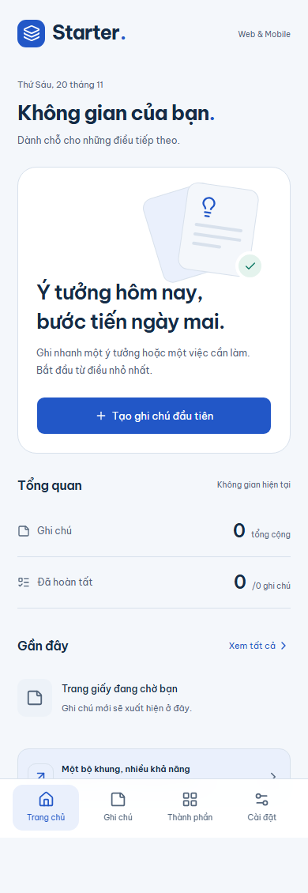

# Web Mobile App PWA Template

Template tiếng Việt dùng lại cho app cá nhân, dựa trên cấu trúc và giao diện [WorkingTimeTracking](https://github.com/khoatdWork/WorkingTimeTracking). Next.js App Router + React + TypeScript strict + shadcn/ui; xuất website tĩnh và cài như PWA. Người tạo dự án phải chọn dịch vụ dữ liệu và hosting trước khi chạy app.

<p>
  
  
  
</p>

## Bắt đầu

Yêu cầu Node **26.4.x**, npm **11.17.0** (theo `.nvmrc` và `package.json`).

```powershell
npm ci
npm run setup
npm run dev
```

Setup hỏi tên app và hai lựa chọn độc lập:

| Nhóm    | Các lựa chọn                                                                                   |
| ------- | ---------------------------------------------------------------------------------------------- |
| Dữ liệu | Local (trên thiết bị), Firebase (Google Auth + Firestore), Supabase (Google Auth + PostgreSQL) |
| Hosting | Cloudflare Pages, GitHub Pages, Firebase Hosting, host tĩnh khác                               |

Ví dụ Supabase + Cloudflare Pages hoặc Firebase + GitHub Pages đều hợp lệ. Lựa chọn lưu trong `project.config.json` để commit cùng dự án; setup tạo namespace storage riêng. `dev`, `build`, `start` và Next config chặn nếu chưa thiết lập. Người dùng app không cần chọn hạ tầng mỗi lần mở.

Chọn Firebase/Supabase thì sao chép `.env.example` thành `.env.local`, điền cấu hình public theo [Firebase](docs/firebase.md) hoặc [Supabase](docs/supabase.md). Khi thiếu cấu hình, app hiển thị rõ dịch vụ chưa được cấu hình và vẫn cho dùng guest local. Chế độ Local không khởi tạo SDK hay gọi dịch vụ cloud.

Mở [localhost:3000](http://localhost:3000). Dữ liệu mặc định trống, không sao chép dữ liệu hoặc tài khoản từ app gốc. Có thể setup không tương tác:

```powershell
npm run setup -- --name "Ghi chú" --data supabase --hosting cloudflare
```

Chạy lại setup để đổi lựa chọn phải xác nhận; với CLI không tương tác, thêm `--yes` sau khi xem cấu hình mới. Namespace giữ nguyên khi đổi dịch vụ, trừ khi chỉ định `--storage-key`. Dữ liệu cloud/tài khoản không tự chuyển dịch vụ; xuất bản sao lưu và nhập có xác nhận trong đúng không gian đích.

## Dùng cho dự án mới

1. Trên GitHub, chọn **Use this template → Create a new repository**. Hoặc chạy `gh repo create TEN-APP --template khoatdWork/Web-Mobile-App-PWA-Template --private --clone`.
2. Chạy `npm ci`, `npm run setup` để chọn tên, dữ liệu và hosting. Commit `project.config.json` của dự án mới. Nếu sao chép từ một app đã setup, chạy setup với `--storage-key` mới để tách dữ liệu app mới. Đổi tên package trong `package.json`, chạy `npm install --package-lock-only`.
3. Sửa mô tả, phiên bản, màu và múi giờ trong `src/config/app.ts`; tên/namespace lấy từ cấu hình setup. Đổi màu tương ứng trong `src/app/globals.css` và `public/icon.svg`, rồi `npm run icons`.
4. Đổi module ví dụ `src/modules/notes` thành nghiệp vụ mới; cập nhật bốn tab ở `src/modules/app-shell/starter-app.tsx`. Có thể bỏ tab Thành phần sau khi tham khảo UI.
5. Nếu chọn tài khoản/cloud, tạo project riêng theo [Firebase](docs/firebase.md) hoặc [Supabase](docs/supabase.md). Chọn hosting theo [hướng dẫn triển khai](docs/hosting.md). Không dùng cấu hình hoặc dữ liệu WorkingTimeTracking.
6. Chạy `npm run verify`, `npm run test:e2e` và kiểm tra cấu hình trước khi triển khai.

## Đã có sẵn

- Khung mobile 320–430px, tối đa 480px trên desktop, bottom navigation, safe area iOS và font Be Vietnam Pro tự host.
- Theme sáng/tối/theo hệ thống, hồ sơ, danh sách Cài đặt theo nhóm.
- Module ghi chú: tạo/sửa/xóa, ý tưởng/công việc, hoàn tất, tìm kiếm, bộ lọc và lưu trên thiết bị.
- shadcn/Radix: Button, Input, Textarea, Label, Badge, Tabs, AlertDialog; toast Sonner và trang trưng bày tương tác.
- Giữ nháp khi lưu lỗi; xác nhận khi bỏ nháp/xóa/nhập/cập nhật; phát hiện bản sửa cũ ở nhiều cửa sổ.
- Sao lưu JSON có kiểm schema, kích thước ≤ 1 MB, tối đa 500 ghi chú; khôi phục lỗi không âm thầm reset dữ liệu gốc.
- Auth/cloud theo adapter Firebase hoặc Supabase. Firebase dùng Google popup + Firestore transaction; Supabase dùng Google OAuth PKCE + PostgreSQL RPC/RLS owner-only. Namespace theo dịch vụ/project/uid, kiểm version và đồng bộ chủ động; không tự ghi đè khi xung đột.
- Manifest, SVG/PNG/maskable/Apple icons, cache phiên bản theo nội dung build, dùng offline và cập nhật có xác nhận.
- Bước setup bắt buộc, dữ liệu/hosting độc lập. Static export cho Cloudflare Pages, GitHub Pages, Firebase Hosting hoặc host tĩnh khác. CI kiểm lint/types/setup/unit/quyền/browser; workflow Pages kiểm đúng lựa chọn hosting trước khi triển khai.

## Cấu trúc

```text
src/app/                   Route, metadata, manifest, global tokens, error pages
project.config.json        Lựa chọn dữ liệu/hosting, tên app và namespace riêng
src/config/                Thương hiệu, timezone và lựa chọn dịch vụ
src/components/ui/         shadcn/Radix primitives dùng chung
src/modules/app-shell/     Ghép màn hình, điều hướng, theme, gallery
src/modules/notes/core/    Domain, schema và kiểm bản sao lưu
src/modules/notes/data/    Local repository, sync policy, Firebase/Supabase adapters
src/modules/auth/          Google Auth qua provider đã chọn
src/modules/settings/      Hồ sơ, theme, tài khoản, PWA, sao lưu
src/modules/pwa/           Service worker template, install/update hook
src/lib/firebase/          Firebase initialization
src/lib/supabase/          Supabase initialization
supabase/migrations/       Schema/RLS và RPC ghi có kiểm version
tests/                     Setup, unit, Firestore emulator, SQL, Chromium/WebKit
scripts/                   Setup/guard, sinh icon, build PWA, static server, browser runner
```

Đọc [Design.md](Design.md), [AGENTS.md](AGENTS.md) và module `CONTEXT.md` để tiếp tục bằng Codex.

## Kiểm tra

```powershell
npm run verify                  # config + lint + types + unit/setup + Supabase SQL + build
python -m pip install -r requirements-dev.txt
python -m playwright install chromium webkit
npm run test:e2e                 # tự mở/đóng static server; cần build trước
npm run test:db                  # cần Java21+; dùng demo project, không chạm cloud thật
npm run test:db:supabase         # PostgreSQL WASM/PGlite, không cần tài khoản/Docker
```

CI chỉ tự setup Local + host tĩnh khi gặp cấu hình template schema 1 còn trống; lựa chọn của dự án đã setup được giữ nguyên. CI chạy Firestore emulator, Supabase SQL và Chromium/WebKit. E2E mặc định kiểm bản không có credentials cloud; kiểm OAuth và cloud thật riêng. Ảnh test nằm ở `output/screenshots/` (không commit). Kết quả và giới hạn nghiệm thu: [docs/verification.md](docs/verification.md).

## Build & triển khai

```powershell
npm run build
npm start
```

PWA chỉ đăng ký worker ở bản production trên HTTPS hoặc localhost. `npm run dev` không có cache offline. Deploy **toàn bộ `out/`**, không deploy source `worker.js`.

Nếu đặt app ở `/ten-repo`, đặt `NEXT_PUBLIC_BASE_PATH=/ten-repo` **trước build** và cùng giá trị khi chạy `npm start`. Đường dẫn này không có dấu `/` ở cuối. Root/custom domain để trống.

Xem lệnh và cấu hình từng host tại [docs/hosting.md](docs/hosting.md). Workflow **Deploy GitHub Pages** chỉ chạy khi dự án chọn `github-pages`; các host khác dùng cùng thư mục `out/` và adapter dữ liệu đã chọn.

## Lưu trữ & đồng bộ

LocalStorage lưu riêng `guest` và từng dịch vụ/project/uid. Đăng nhập/đăng xuất không tự nhập hoặc xóa dữ liệu không gian khác. Muốn chuyển ghi chú khách sang tài khoản, xuất JSON ở guest rồi đăng nhập và nhập lại có xác nhận. Với app Firebase phiên bản trước chỉ lưu khóa theo uid: xuất JSON từ bản cũ trước khi nâng cấp rồi nhập ở bản mới; app giữ nguyên khóa cũ nhưng không tự gán sang project mới.

Mỗi lần sửa lưu local trước. Tài khoản bấm **Đồng bộ ngay** để nhận cloud khi local sạch hoặc gửi local khi phiên bản cloud khớp. Nếu cả hai thay đổi, app chặn ghi đè và yêu cầu đối chiếu. **Tải bản đám mây** có xác nhận vì sẽ thay bản thiết bị. Chỉ báo dịch vụ xác nhận sau server read/transaction/RPC thành công và cập nhật local thành công. Không có đồng bộ ngầm hay merge tự động.

App này là bộ khung; trước khi dùng nghiệp vụ quan trọng, thiết kế schema, quy tắc phân quyền và chiến lược xung đột phù hợp. Trình duyệt có thể xóa dữ liệu local; hãy xuất sao lưu hoặc đồng bộ thường xuyên. Không lưu token quản trị/service-account trong app client.
