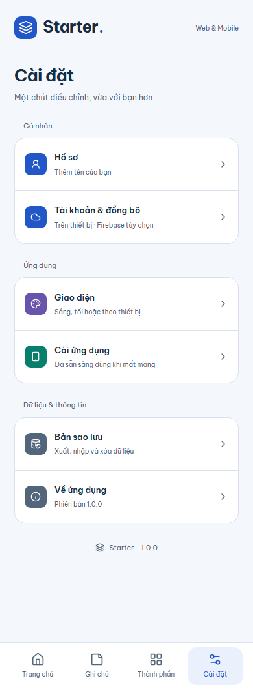
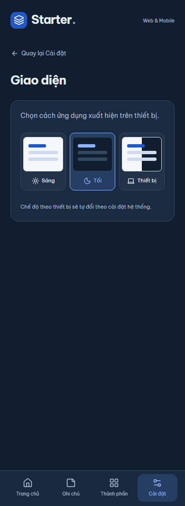

# Web Mobile App PWA Template

Template tiếng Việt dùng lại cho app cá nhân, dựa trên cấu trúc và giao diện [WorkingTimeTracking](https://github.com/khoatdWork/WorkingTimeTracking). Next.js App Router + React + TypeScript strict + shadcn/ui + Firebase tùy chọn; xuất website tĩnh và cài như PWA.

<p>
  
  
  
</p>

## Bắt đầu

Yêu cầu Node **26.4.x**, npm **11.17.0** (theo `.nvmrc` và `package.json`).

```powershell
npm ci
Copy-Item .env.example .env.local
npm run dev
```

Mở [localhost:3000](http://localhost:3000). Không cần Firebase để chạy. Dữ liệu mặc định trống, không sao chép dữ liệu hoặc cấu hình tài khoản từ app gốc.

## Dùng cho dự án mới

1. Trên GitHub, chọn **Use this template → Create a new repository**. Hoặc chạy `gh repo create TEN-APP --template khoatdWork/Web-Mobile-App-PWA-Template --private --clone`.
2. Đổi tên package trong `package.json`, chạy `npm install --package-lock-only`.
3. Sửa `src/config/app.ts`: tên, mô tả, phiên bản, **storageKey riêng cho mỗi app**, màu và múi giờ. Đổi màu tương ứng trong `src/app/globals.css` và `public/icon.svg`, rồi `npm run icons`.
4. Đổi module ví dụ `src/modules/notes` thành nghiệp vụ mới; cập nhật bốn tab ở `src/modules/app-shell/starter-app.tsx`. Có thể bỏ tab Thành phần sau khi tham khảo UI.
5. Nếu cần tài khoản/cloud, tạo Firebase project riêng theo [hướng dẫn](docs/firebase.md). Không dùng cấu hình hoặc dữ liệu WorkingTimeTracking.
6. Chạy `npm run verify`, `npm run test:e2e` và kiểm tra cấu hình trước khi triển khai.

## Đã có sẵn

- Khung mobile 320–430px, tối đa 480px trên desktop, bottom navigation, safe area iOS và font Be Vietnam Pro tự host.
- Theme sáng/tối/theo hệ thống, hồ sơ, danh sách Cài đặt theo nhóm.
- Module ghi chú: tạo/sửa/xóa, ý tưởng/công việc, hoàn tất, tìm kiếm, bộ lọc và lưu trên thiết bị.
- shadcn/Radix: Button, Input, Textarea, Label, Badge, Tabs, AlertDialog; toast Sonner và trang trưng bày tương tác.
- Giữ nháp khi lưu lỗi; xác nhận khi bỏ nháp/xóa/nhập/cập nhật; phát hiện bản sửa cũ ở nhiều cửa sổ.
- Sao lưu JSON có kiểm schema, kích thước ≤ 1 MB, tối đa 500 ghi chú; khôi phục lỗi không âm thầm reset dữ liệu gốc.
- Google Auth và Firestore owner-only, namespace theo uid, transaction kiểm version; chủ động bấm Đồng bộ, không tự ghi đè khi xung đột.
- Manifest, SVG/PNG/maskable/Apple icons, cache phiên bản theo nội dung build, dùng offline và cập nhật có xác nhận.
- Static export hỗ trợ đường dẫn con GitHub Pages; CI kiểm lint/types/unit/rules/browser và workflow triển khai Pages tùy chọn.

## Cấu trúc

```text
src/app/                   Route, metadata, manifest, global tokens, error pages
src/config/app.ts          Thương hiệu, namespace, phiên bản, timezone
src/components/ui/         shadcn/Radix primitives dùng chung
src/modules/app-shell/     Ghép màn hình, điều hướng, theme, gallery
src/modules/notes/core/    Domain, schema và kiểm bản sao lưu
src/modules/notes/data/    Local repository, sync policy, Firebase adapter
src/modules/auth/          Google Auth tùy chọn
src/modules/settings/      Hồ sơ, theme, tài khoản, PWA, sao lưu
src/modules/pwa/           Service worker template, install/update hook
src/lib/firebase/          Firebase initialization
tests/                     Unit, Firestore emulator, Chromium/WebKit
scripts/                   Sinh icon, build PWA, static server, browser runner
```

Đọc [Design.md](Design.md), [AGENTS.md](AGENTS.md) và module `CONTEXT.md` để tiếp tục bằng Codex.

## Kiểm tra

```powershell
npm run verify                  # lint + typecheck + unit + production build
python -m pip install -r requirements-dev.txt
python -m playwright install chromium webkit
npm run test:e2e                 # tự mở/đóng static server; cần build trước
npm run test:db                  # cần Java21+; dùng demo project, không chạm cloud thật
```

CI chạy cả Firestore emulator và Chromium/WebKit. Ảnh test nằm ở `output/screenshots/` (không commit). Kết quả và giới hạn nghiệm thu: [docs/verification.md](docs/verification.md).

## Build & triển khai

```powershell
npm run build
npm start
```

PWA chỉ đăng ký worker ở bản production trên HTTPS hoặc localhost. `npm run dev` không có cache offline. Deploy **toàn bộ `out/`**, không deploy source `worker.js`.

Nếu đặt app ở `/ten-repo`, đặt `NEXT_PUBLIC_BASE_PATH=/ten-repo` **trước build** và cùng giá trị khi chạy `npm start`. Đường dẫn này không có dấu `/` ở cuối. Root/custom domain để trống.

GitHub Pages: bật **Settings → Pages → Source: GitHub Actions**, sau đó chạy thủ công workflow **Deploy GitHub Pages**. Workflow tự lấy tên repository làm base path; với custom domain hoặc repo `owner.github.io`, đặt repository variable `PAGES_BASE_PATH=/`. Gói GitHub của bạn cần hỗ trợ Pages cho repo private; có thể deploy `out/` lên host tĩnh khác. Không cần Pages để dùng template.

## Lưu trữ & đồng bộ

LocalStorage lưu riêng `guest` và từng Firebase uid. Đăng nhập/đăng xuất không tự nhập hoặc xóa dữ liệu không gian khác. Muốn chuyển ghi chú khách sang tài khoản, xuất JSON ở guest rồi đăng nhập và nhập lại có xác nhận.

Mỗi lần sửa lưu local trước. Tài khoản bấm **Đồng bộ ngay** để nhận cloud khi local sạch hoặc gửi local khi phiên bản cloud khớp. Nếu cả hai thay đổi, app chặn ghi đè và yêu cầu đối chiếu. **Tải bản đám mây** có xác nhận vì sẽ thay bản thiết bị. Chỉ báo Firebase xác nhận sau transaction/server read thành công. Không có đồng bộ ngầm, merge tự động hay queue Firestore persistent.

App này là bộ khung; trước khi dùng nghiệp vụ quan trọng, thiết kế schema, quy tắc phân quyền và chiến lược xung đột phù hợp. Trình duyệt có thể xóa dữ liệu local; hãy xuất sao lưu hoặc đồng bộ thường xuyên. Không lưu token quản trị/service-account trong app client.
